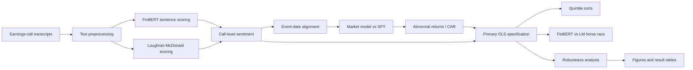
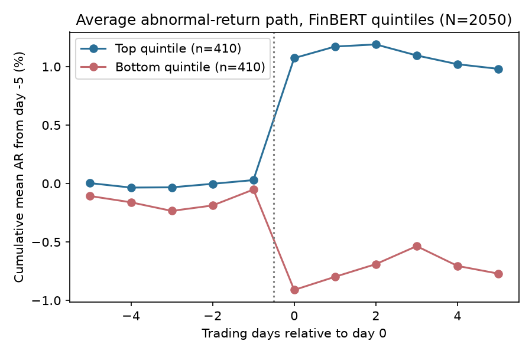

# Earnings Call Sentiment Analyzer

[](https://www.python.org/)
[](https://pytorch.org/)
[](https://huggingface.co/docs/transformers/)
[](https://github.com/ranaroussi/yfinance)
[](https://pytest.org/)
[](https://docs.astral.sh/ruff/)
[](LICENSE)

Scores earnings-call transcripts with **FinBERT** (`ProsusAI/finbert`) and the **Loughran-McDonald (LM)** dictionary, then evaluates whether call tone is associated with abnormal stock returns around the call.

The project asks two questions:

1. Does earnings-call tone explain abnormal returns over the 1–5 trading days after the call?
2. Does FinBERT provide information beyond the traditional Loughran-McDonald dictionary?

**Short answer:** both sentiment measures are strongly associated with the market reaction in the primary specification (t = 5.1, N = 2,050). The reaction is concentrated on **day 0** and does not exhibit meaningful post-call drift. **FinBERT does not outperform LM**: LM is at least as strong on its own and absorbs most of FinBERT's incremental effect when both measures are included. Because the study has **no earnings-surprise data**, the estimates are associations rather than causal effects.

## Key Results

| Analysis | Result |
|---|---:|
| Primary FinBERT coefficient | +0.88 pp per +1 SD |
| Primary t-statistic | 5.15 |
| Events | 2,050 |
| Firms | 60 |
| Adjusted R² | 0.017 |
| FinBERT quintile spread | +1.89 pp |
| LM quintile spread | +2.63 pp |
| FinBERT-only coefficient | +0.88 pp (t = 5.15) |
| LM-only coefficient | +1.00 pp (t = 5.32) |
| Both: FinBERT | +0.28 pp (t = 1.49) |
| Both: LM | +0.79 pp (t = 3.62) |
| FinBERT / LM Spearman correlation | 0.76 |

The evidence supports a strong association between call tone and the contemporaneous market reaction, but it does **not** establish that sentiment itself causes the return.

## Architecture



## Data

| Source | Description |
|---|---|
| **Transcripts** | `kurry/sp500_earnings_transcripts` on Hugging Face. Listed as MIT licensed for research/educational use; original provenance is not stated. Transcripts are not redistributed by this project. |
| **Equity prices** | `yfinance` adjusted close data with SPY as the market benchmark, downloaded 2026-11-06. |
| **Sentiment lexicon** | Loughran-McDonald Master Dictionary 1993–2025 from Notre Dame SRAF, downloaded 2026-11-06. |
| **Universe** | 60 tickers selected with sector stratification and a seeded procedure; each has at least 16 calls during 2015–2024. |
| **Events** | 2,062 calls and 869,072 sentences in the source sample; 2,050 events enter the primary regression. |

Additional provenance, licensing information, schemas, and the build log are documented in:

- `docs/data_sources.md`
- `docs/schemas.md`
- `docs/progress.md`

## Methodology

### 1. Sentiment scoring

Two independent sentiment measures are computed for every transcript:

- **FinBERT:** `ProsusAI/finbert`, scored sentence by sentence using the mean of `P(positive) - P(negative)`.
- **Loughran-McDonald:** dictionary score defined as `(positive words - negative words) / total words`.

Both measures are calculated for:

- the complete transcript,
- prepared remarks,
- Q&A.

Over-long sentences are chunked before FinBERT inference and token coverage is asserted. FinBERT outputs are cached at a pinned model revision, making the CPU pipeline resumable and reproducible. The full 869k-sentence scoring run takes roughly five hours on CPU.

### 2. Event-date alignment

The study derives day 0 from the reported call start time, assuming US Eastern Time because the source does not document its timezone.

**Primary alignment rule:**

- before market open → call date
- during market hours → call date
- after market close → next trading day

A PRD-style rule that maps during-market calls to the following trading day is retained as a robustness specification.

For the 916 events beginning during market hours, mean absolute abnormal return is 3.3% on the call date versus 1.7% on the following day. The primary alignment rule was selected before the sentiment-vs-return results were evaluated.

### 3. Abnormal returns

Abnormal returns are estimated using a market model against SPY:

- estimation window: trading days **[-250, -30]**
- at least 120 estimation observations
- other earnings reactions masked from estimation
- estimation window ends strictly before day 0
- CAR[0,+k] is the cumulative abnormal return from day 0 through day k

Market-adjusted returns are also evaluated as an alternative specification.

### 4. Primary specification

The pre-declared primary regression is:

**FinBERT call-level score → CAR[0,+1]**

with controls for:

- prior return,
- pre-event volatility,
- log dollar volume,

all measured over days **[-60, -2]**, plus:

- sector fixed effects,
- year-quarter fixed effects,
- firm-clustered standard errors.

All non-primary analyses are treated as exploratory.

## Results

### Primary specification

FinBERT sentiment is positively associated with CAR[0,+1]:

- coefficient: **+0.88 pp**
- standard error: **0.17**
- t-statistic: **5.15**
- observations: **2,050**
- firms: **60**
- adjusted R²: **0.017**

The coefficient is unchanged in magnitude under alternative inference:

- firm × date two-way clustering: t = 5.01
- HC1 standard errors: t = 5.95

Tone is standardized, so the coefficient represents the change in CAR associated with a **+1 standard deviation** increase in FinBERT sentiment.

### Sentiment quintiles

| Quintile | FinBERT CAR[0,+1] |
|---|---:|
| Q1 | -0.75% |
| Q5 | +1.14% |
| Q5 − Q1 | +1.89 pp |

The extreme-quintile FinBERT comparison contains 820 events and has a firm-clustered t-statistic of 4.0.

For LM:

- Q5 − Q1 spread: **+2.63 pp**
- firm-clustered t-statistic: **5.1**

These are pooled descriptive sorts, **not a tradable strategy**.

### FinBERT vs LM

The horse race is the key comparison:

| Model | FinBERT coefficient (t) | LM coefficient (t) | Adjusted R² |
|---|---:|---:|---:|
| FinBERT only | 0.88 pp (5.15) | — | 0.0174 |
| LM only | — | 1.00 pp (5.32) | 0.0224 |
| Both | 0.28 pp (1.49) | 0.79 pp (3.62) | 0.0227 |

The two sentiment measures have a **Spearman correlation of 0.76**.

When both are included, LM remains statistically significant while FinBERT does not. Within this dataset and specification, there is therefore **no detectable incremental contribution from FinBERT beyond LM**.

## Robustness

The project evaluates **288 exploratory regressions** spanning:

- 4 day-0 alignment rules
- 2 return models
- 3 transcript sections
- 3 event windows
- winsorised vs non-winsorised outcomes
- both sentiment scorers

The share of regressions with p < 0.05 is:

| Scorer | Significant specifications |
|---|---:|
| FinBERT | 74% |
| LM | 85% |
| Overall | 79% |

Selected CAR[0,+1] market-model results with firm-clustered standard errors:

| Day-0 rule | Section | FinBERT t | LM t |
|---|---|---:|---:|
| Primary | All | 5.1 | 5.3 |
| Primary | Prepared / Q&A | 3.7 / 3.5 | 2.9 / 3.6 |
| PRD rule | All | 4.2 | 4.4 |
| Next-day always | All | 2.6 | 3.4 |

Longer windows remain directionally similar:

- CAR[0,+3]: approximately 0.8 pp
- CAR[0,+5]: approximately 0.8 pp
- corresponding t-statistics: roughly 3.6–4.2

Winsorising CAR at the 1st/99th percentiles does not materially change the conclusions.

Prepared remarks and Q&A are each informative, although their effects are weaker than the pooled transcript.

Because 288 specifications are reported, results outside the pre-declared primary specification should be interpreted as **descriptive rather than confirmatory**.

## Event-Reaction Path

The tone-sorted return spread opens on **day 0** and then remains flat or partially reverses.



This pattern is consistent with a same-day reaction to information contained in the earnings call rather than a persistent post-call drift.

Additional figures include:

- sentiment distribution
- FinBERT vs LM scatter
- CAR by sentiment quintile
- CAR path for top vs bottom quintiles
- horse-race coefficient comparison

Generated outputs are available under:

- `results/tables/`
- `results/figures/`

## Limitations

### No earnings-surprise control

This is the central limitation. Tone is likely correlated with the actual-vs-consensus earnings surprise, which itself drives the market reaction. Without surprise data, the reported coefficients should be interpreted as **associations, not causal effects**.

### Universe selection and survivorship

The basket is based on the current S&P 500 list, requires a currently available sector classification, and requires at least 16 calls during 2015–2024. Firms that left the index or were delisted are therefore underrepresented.

### Transcript provenance and timing

The transcript source has unverified original provenance. Call times are assumed to be US Eastern Time, although this timezone is not documented by the source. Nine calls have unknown times and are excluded from the PRD/alternative alignment rules; three additional calls lack sufficient estimation data.

Approximately 9% of calls do not have a detectable prepared-remarks/Q&A split.

### Dependence and sample composition

The primary sample contains 2,050 events across 60 firms. Earnings seasons create calendar clustering, while 2020 is heavily represented. These dependencies may affect precision despite firm-level and two-way clustering.

### Other limitations

- Event windows do not overlap under the six-day rule; calls occur roughly once per quarter.
- Other earnings reactions are masked from estimation windows.
- Size is proxied using trailing dollar volume rather than look-ahead market capitalization.
- NLTK Punkt sentence splitting is imperfect around abbreviations.
- FinBERT was not fine-tuned specifically for earnings-call language.
- The study contains one pre-declared primary specification and 288 exploratory regressions.

## Reproduction

### Environment

Python 3.12 is used for the project.

```bash
python -m venv .venv
make setup
```

### Data

The LM Master Dictionary CSV must be downloaded to:

```
data/raw/LM_MasterDictionary.csv
```

See `docs/data_sources.md` for source and licensing details.

Then:

```bash
make data
```

This downloads/builds the basket, transcripts, and price data. Network access is required.

### Sentiment scoring

```bash
make score
```

Runs both LM and FinBERT scoring. The FinBERT stage can take hours on CPU and is cached/resumable.

### Event study

```bash
make events
```

Computes day-0 alignment, market-model parameters, abnormal returns, and CAR.

### Analysis and reporting

```bash
make analyze
make report
```

Runs the statistical analysis, robustness checks, and report generation.

### Validation

```bash
make test
make lint
```

Project configuration is defined in `configs/default.yaml`. The `data/` directory is git-ignored and transcript data is never committed.

## Project Structure

```
.
├── configs/            # Analysis configuration
├── data/               # Local, git-ignored data
├── docs/               # Data sources, schemas, and build notes
├── results/
│   ├── figures/        # Generated figures
│   └── tables/         # Generated statistical tables
├── scripts/             # Data, scoring, event-study, and reporting pipelines
├── src/                # Core analysis code
├── tests/               # Unit and validation tests
├── Makefile             # Reproducible pipeline commands
└── pyproject.toml       # Python/Ruff/pytest configuration
```

## References

- Yang, Uy, Huang (2020), **FinBERT**
- Loughran & McDonald (2011), **When Is a Liability Not a Liability?**
- MacKinlay (1997), **Event Studies in Economics and Finance**

## License

This project is released under the **MIT License**. The transcript dataset and LM dictionary are third-party materials with their own licensing and usage restrictions. See `docs/data_sources.md` before downloading or redistributing external data.
